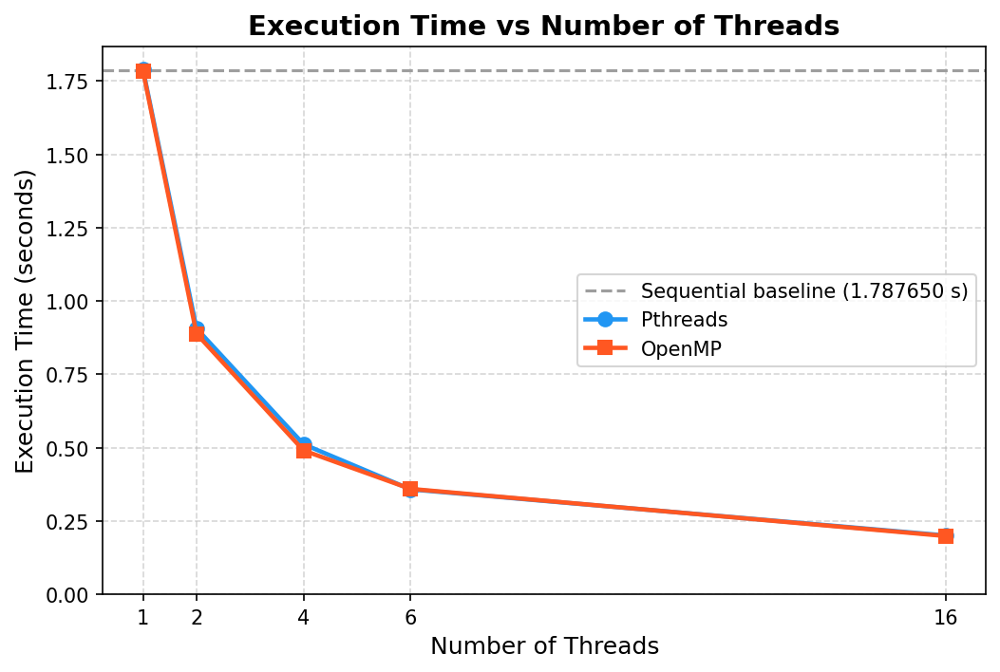
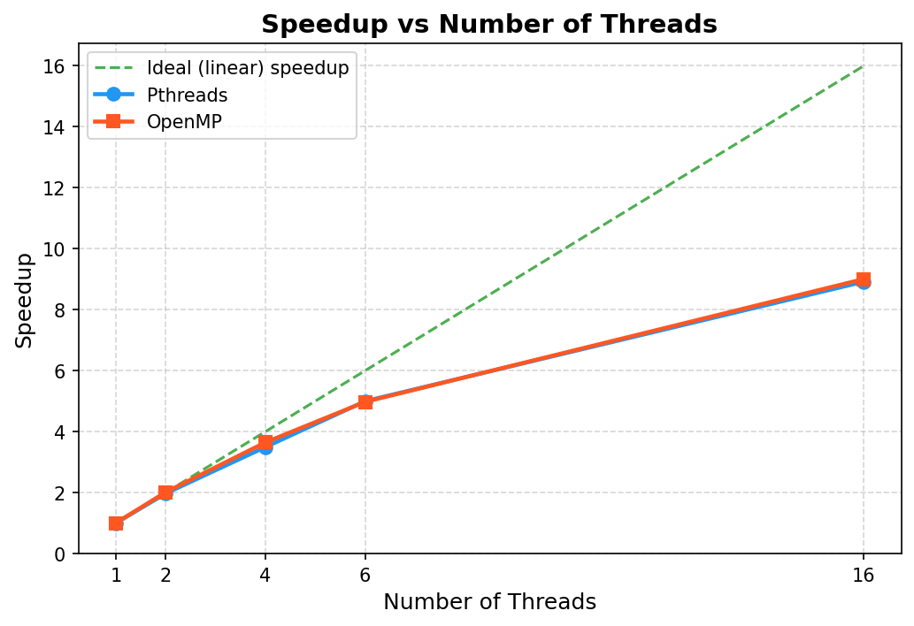
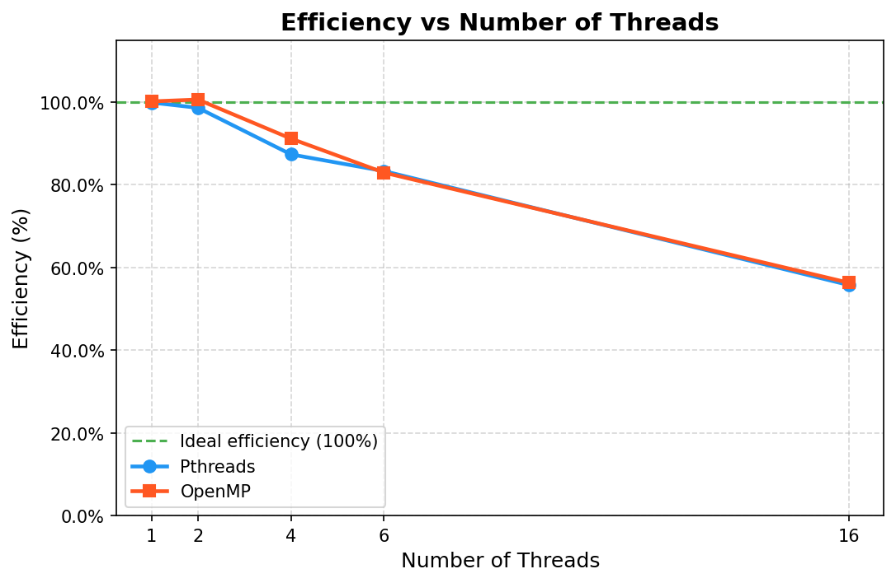
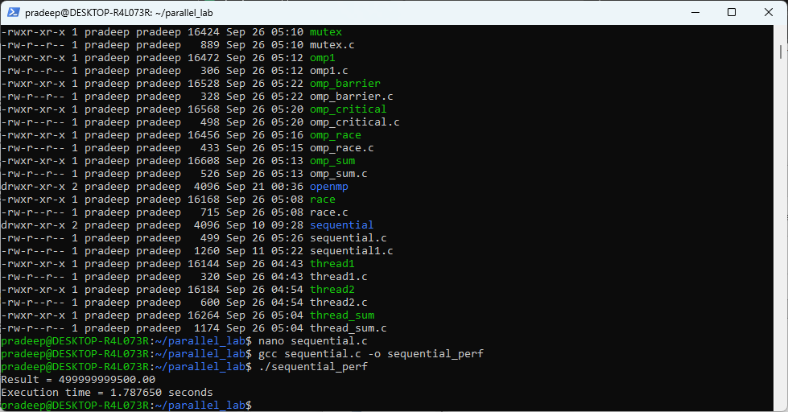
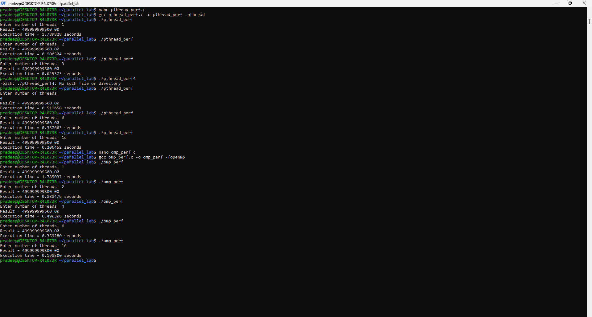

# Multithreaded Programming Using Pthreads and OpenMP

## Overview

This project explores multithreaded programming and parallel computing principles using two standard parallel programming models:
- **POSIX Threads (Pthreads)**: Low-level API providing explicit control over thread creation, execution, and synchronization.
- **OpenMP**: High-level, compiler-directive-driven API offering implicit thread management, automated work distribution, and structured coordination.

The experiment systematically demonstrates:
- Thread creation and lifecycle management (`pthread_create`, `pthread_join`)
- Work sharing and domain decomposition
- Race conditions arising from unsynchronized shared-memory access
- Mutual exclusion and synchronization mechanisms (`pthread_mutex_t`, `#pragma omp critical`)
- Thread coordination using barrier synchronization (`#pragma omp barrier`)
- Reduction operations for partial accumulations
- Benchmarking, speedup, and efficiency evaluation comparing Sequential, Pthreads, and OpenMP implementations

---

## Objectives

1. Understand the core principles of parallel programming and thread-based concurrency.
2. Develop C programs demonstrating explicit thread creation and joining using **Pthreads**.
3. Develop C programs utilizing **OpenMP** compiler directives for parallel execution and work-sharing loops.
4. Demonstrate concurrency hazards, specifically race conditions on shared memory variables.
5. Apply synchronization primitives (mutex locks and critical sections) to ensure thread-safe execution.
6. Coordinate thread execution phases using barrier synchronization.
7. Conduct empirical performance benchmarking across varying thread counts (1, 2, 4, 6, and 16 threads).
8. Calculate and analyze **Speedup** and **Parallel Efficiency** against a single-threaded sequential baseline to understand scalability and parallel overhead.

---

## Environment

- **Operating System:** Linux (Ubuntu under Windows Subsystem for Linux — WSL)
- **Compiler:** GCC (GNU Compiler Collection)
- **Programming Language:** C (C99 / C11)
- **Parallel Libraries & Flags:**
  - POSIX Threads: `-pthread`
  - OpenMP: `-fopenmp`

### Compilation & Execution Commands

**Pthreads Programs:**
```bash
gcc filename.c -o filename -pthread
./filename
```

**OpenMP Programs:**
```bash
gcc filename.c -o filename -fopenmp
./filename
```

**Sequential Program:**
```bash
gcc sequential.c -o sequential
./sequential
```

---

## Project Structure

```text
Multithreaded-Pthreads-OpenMP/
├── README.md
├── .gitignore
├── pthreads/
│   ├── thread1.c
│   ├── thread2.c
│   ├── thread_sum.c
│   ├── race.c
│   ├── mutex.c
│   └── pthread_perf.c
├── openmp/
│   ├── omp1.c
│   ├── omp_sum.c
│   ├── omp_race.c
│   ├── omp_critical.c
│   ├── omp_barrier.c
│   └── omp_perf.c
├── performance/
│   ├── sequential.c
│   ├── generate_graphs.py
│   ├── performance_results.csv
│   └── graphs/
│       ├── execution_time.png
│       ├── speedup.png
│       └── efficiency.png
└── screenshots/
    ├── sequential_result.png
    └── parallel_performance.png
```

---

## Pthreads Programs

| Program | Source File | Description | Key Functions / Concepts |
|---|---|---|---|
| **Step 1: Single Thread** | [`pthreads/thread1.c`](pthreads/thread1.c) | Creates a single worker thread, executes a target function, and joins back to the main thread. | `pthread_create`, `pthread_join` |
| **Step 2: Multiple Threads** | [`pthreads/thread2.c`](pthreads/thread2.c) | Spawns 4 concurrent threads with unique thread IDs. Demonstrates non-deterministic operating system scheduling. | Thread arrays, argument passing |
| **Step 3: Work Distribution** | [`pthreads/thread_sum.c`](pthreads/thread_sum.c) | Divides an 8-element array evenly across 4 threads. Each computes a local partial sum before aggregating into the final total (360). | Work chunking, sub-array summation |
| **Step 4: Race Condition** | [`pthreads/race.c`](pthreads/race.c) | 4 threads concurrently increment a shared variable 100,000 times each without synchronization, resulting in lost updates. | Shared memory, race hazard |
| **Step 5: Mutex Protection** | [`pthreads/mutex.c`](pthreads/mutex.c) | Resolves the race condition by locking the critical section using a mutex, ensuring the exact expected count of 400,000. | `pthread_mutex_init`, `pthread_mutex_lock`, `pthread_mutex_unlock` |
| **Step 6: Pthreads Performance** | [`pthreads/pthread_perf.c`](pthreads/pthread_perf.c) | Measures execution time for summing $N = 1,000,000,000\text{ iterations}$ across user-specified thread counts (1, 2, 4, 6, 16) using monotonic clock timing. | `clock_gettime(CLOCK_MONOTONIC)`, chunking |

---

## OpenMP Programs

| Program | Source File | Description | Key Directives / Concepts |
|---|---|---|---|
| **Step 7: Basic Parallel Region** | [`openmp/omp1.c`](openmp/omp1.c) | Spawns a parallel team of threads, each printing its unique thread identifier and the total team size. | `#pragma omp parallel`, `omp_get_thread_num()`, `omp_get_num_threads()` |
| **Step 8: Work Sharing & Reduction** | [`openmp/omp_sum.c`](openmp/omp_sum.c) | Uses OpenMP loop work sharing and a reduction clause to compute the array sum across threads without race conditions. | `#pragma omp parallel for reduction(+:total_sum)` |
| **Step 9: Race Condition** | [`openmp/omp_race.c`](openmp/omp_race.c) | Demonstrates race conditions in OpenMP when 4 parallel threads concurrently increment an unprotected shared counter. | Unsynchronized parallel region |
| **Step 10: Critical Section** | [`openmp/omp_critical.c`](openmp/omp_critical.c) | Restricts access to the shared counter increment to one thread at a time using a critical section. | `#pragma omp critical` |
| **Step 11: Barrier Synchronization** | [`openmp/omp_barrier.c`](openmp/omp_barrier.c) | Enforces phase synchronization: all threads complete Stage 1 before any thread proceeds to Stage 2. | `#pragma omp barrier` |
| **Step 12: OpenMP Performance** | [`openmp/omp_perf.c`](openmp/omp_perf.c) | Benchmarks parallel computation of $N = 1,000,000,000\text{ iterations}$ using OpenMP work sharing and reduction across 1, 2, 4, 6, and 16 threads. | `#pragma omp parallel for reduction(+:sum)`, `omp_set_num_threads()` |

---

## Performance Analysis

To evaluate execution performance, a large computational workload was benchmarked across a sequential implementation, Pthreads, and OpenMP:
- **Workload:** Numerical accumulation $\sum_{i=0}^{N-1} (i \times 10^{-6})$ for **$N = 1,000,000,000\text{ iterations}$**.
- **Verification Result:** All sequential and parallel runs produced the identical verified mathematical sum:
  $$\text{Result} = 499999999500.00$$
- **Sequential Baseline Execution Time ($T_{\text{seq}}$):** `1.787650 seconds` (measured via [`performance/sequential.c`](performance/sequential.c))
- **Benchmark Thread Counts:** 1, 2, 4, 6, and 16 threads.

---

## Actual Results

The following table summarizes the actual execution times measured on the test machine.

| Number of Threads | Pthreads Execution Time (s) | OpenMP Execution Time (s) |
|:---:|:---:|:---:|
| **1** | 1.789828 | 1.785037 |
| **2** | 0.906504 | 0.888479 |
| **4** | 0.511658 | 0.490306 |
| **6** | 0.357663 | 0.359280 |
| **16** | 0.200452 | 0.198500 |

*Sequential baseline execution time: **1.787650 seconds**.*  
*Raw benchmark records are maintained in [`performance/performance_results.csv`](performance/performance_results.csv).*

---

## Speedup

Speedup quantifies how much faster the parallel program executes compared to the sequential baseline:

$$\text{Speedup} = \frac{T_{\text{seq}}}{T_{\text{parallel}}}$$

| Threads | Sequential Time (s) | Pthreads Time (s) | Pthreads Speedup | OpenMP Time (s) | OpenMP Speedup |
|:---:|:---:|:---:|:---:|:---:|:---:|
| **1** | 1.787650 | 1.789828 | **0.9988x** | 1.785037 | **1.0015x** |
| **2** | 1.787650 | 0.906504 | **1.9720x** | 0.888479 | **2.0120x** |
| **4** | 1.787650 | 0.511658 | **3.4938x** | 0.490306 | **3.6460x** |
| **6** | 1.787650 | 0.357663 | **4.9981x** | 0.359280 | **4.9756x** |
| **16** | 1.787650 | 0.200452 | **8.9181x** | 0.198500 | **9.0058x** |

**Observations:**
- Speedup scales nearly linearly from 1 to 2 threads (~1.97x–2.01x) and continues strong scaling through 6 threads (~5.0x).
- At 16 threads, speedup reaches approximately **8.92x (Pthreads)** and **9.01x (OpenMP)**.

---

## Efficiency

Parallel efficiency measures how effectively the computational resources (threads) are utilized relative to ideal linear speedup:

$$\text{Efficiency (\%)} = \left(\frac{\text{Speedup}}{\text{Number of Threads}}\right) \times 100$$

| Threads | Pthreads Speedup | Pthreads Efficiency (%) | OpenMP Speedup | OpenMP Efficiency (%) |
|:---:|:---:|:---:|:---:|:---:|
| **1** | 0.9988x | **99.88%** | 1.0015x | **100.15%** |
| **2** | 1.9720x | **98.60%** | 2.0120x | **100.60%** |
| **4** | 3.4938x | **87.34%** | 3.6460x | **91.15%** |
| **6** | 4.9981x | **83.30%** | 4.9756x | **82.93%** |
| **16** | 8.9181x | **55.74%** | 9.0058x | **56.29%** |

> **Note on Efficiency Values > 100%:**  
> The slight values above 100% observed at low thread counts (e.g., OpenMP 1 thread at 100.15% and 2 threads at 100.60%) are mathematically produced because the parallel runs were measured independently from the sequential baseline run. Minor millisecond-level run-to-run timing variations caused by CPU frequency governors, OS scheduling, or cache state naturally account for these small variations around 100%.

**Observations:**
- At low thread counts (1–2 threads), parallel efficiency is close to 100%, indicating minimal synchronization and management overhead.
- As thread counts increase to 4 and 6, efficiency remains robust above 82%.
- At 16 threads, efficiency drops to ~56% due to hardware limitations (physical core availability), context switching, thread scheduling, and memory bus bandwidth constraints.

---

## Graphs

### 1. Execution Time vs. Number of Threads
Shows the decrease in execution time as thread count increases, compared against the sequential baseline.



### 2. Speedup vs. Number of Threads
Shows the measured speedup curves for Pthreads and OpenMP against the ideal linear speedup line.



### 3. Efficiency vs. Number of Threads
Illustrates parallel efficiency across thread counts relative to 100% ideal efficiency.



---

## Screenshots

### 1. Sequential Baseline Execution
Shows compilation, execution, output verification (`499999999500.00`), and baseline time (`1.787650 seconds`).



### 2. Parallel Performance Benchmark
Shows combined Pthreads and OpenMP multi-thread benchmark runs across 1, 2, 4, 6, and 16 threads producing consistent verified output `499999999500.00`.



---

## Conclusion

This experiment demonstrates multithreaded programming concepts and performance trade-offs using Pthreads and OpenMP:

1. **Programming Paradigms:**
   - **Pthreads** provides granular control over individual thread life cycles and memory structures, requiring explicit chunk calculation and join operations.
   - **OpenMP** simplifies development through declarative compiler directives (`#pragma omp parallel for reduction`), achieving comparable execution times with significantly less boilerplate code.

2. **Synchronization & Concurrency Hazards:**
   - Unsynchronized concurrent modification of shared variables leads to race conditions and corrupted data in both models.
   - Mutexes (`pthread_mutex_t`) and critical sections (`#pragma omp critical`) reliably eliminate race hazards at the cost of sequential serialization for protected regions.

3. **Performance & Scalability:**
   - Both implementations reduced execution time from **1.788 seconds down to ~0.200 seconds**, achieving a peak speedup of **~9.0x**.
   - Near-linear scaling was achieved at lower thread counts (1 to 2 threads with >98% efficiency).
   - Real-world parallel scaling deviates from theoretical linearity at higher thread counts (16 threads at ~56% efficiency) due to physical core limits, thread scheduling overhead, context switching, and memory bus saturation.
